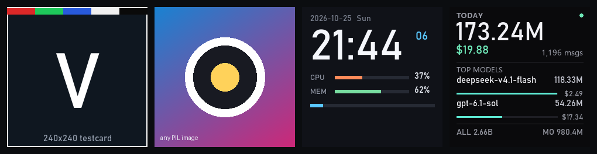
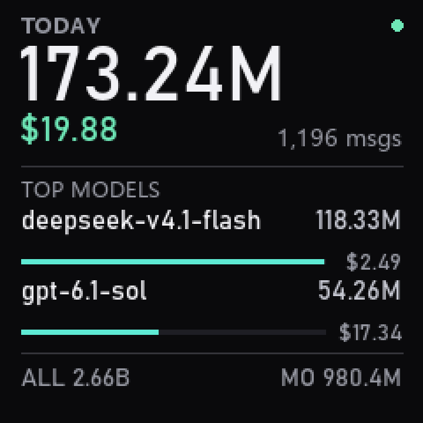

# valkyrie-240-lcd

**瓦尔基里 / Myth.Cool 水冷副屏（240×240，MS9132）的协议实现 + 推流工具包**

把这块屏当一块普通的 240×240 画布：你用 Pillow 画什么，它就显示什么。
协议、初始化、像素格式这些麻烦事已经包好了，跑通的东西都在这里。



*左起：测试卡 → 任意图片 → 实时时钟/系统占用 → **作者本人在用的 Token 用量看板**。四张都是这个仓库自己的代码渲染出来的。*

---

## 这是什么

一块瓦尔基里水冷头上的小方屏，规格：

| 项 | 值 |
|---|---|
| 物理分辨率 | 240×240 |
| USB | `VID_345F` / `PID_9132`（复合设备，多个面板型号共用这组 ID） |
| 桥接芯片 | MacroSilicon MS9132 |
| 控制通道 | `MI_00` HID 特征报文 |
| 像素通道 | `MI_03` bulk OUT，端点 `0x04`，需绑 `libusb-win32` |
| 像素格式 | YUV422 (UYVY)，2 字节/像素 |
| VIC（视频模式码） | 156 |
| 整帧长度 | 115216 字节 = 8 + 240×240×2 + 8 |

官方只提供闭源客户端。这个仓库是把协议还原出来、验证通过之后的开源实现，
**参数全部来自官方驱动自己的日志**，不是猜的（见 [docs/PROTOCOL.md](docs/PROTOCOL.md) 第六节教你怎么自己复核）。

---

## 三步上手

```bash
git clone https://github.com/hogancv/valkyrie-240-lcd
cd valkyrie-240-lcd
pip install -r requirements.txt
```

先自检，再点灯：

```bash
python tools/doctor.py                  # 环境 / 驱动 / 设备 / HID 全查一遍
python examples/01_testcard.py          # 屏上出现测试卡 = 链路通了
```

然后随便推点东西：

```bash
python examples/02_image.py photo.jpg           # 推图片（自动裁切填满）
python examples/03_gif.py cat.gif               # 推 GIF 动画
python examples/04_live_panel.py                # 实时时钟 + CPU/内存
python demos/token-board/run.py                 # 作者本人在用的 Token 用量看板
```

自己写的话，核心就这几行：

```python
from PIL import Image
from valkyrie_lcd import ValkyriePanel

img = Image.new("RGB", (240, 240), (20, 30, 40))

with ValkyriePanel() as panel:      # 自动跑完 76 条初始化
    panel.show(img)                 # 推一帧
    panel.stream([img], fps=5, seconds=10)   # 或者连续推
```

---

## 能力一览

| 需求 | 接口 |
|---|---|
| 推一帧 `PIL.Image` | `panel.show(img)` |
| 推图片文件 | `panel.show_file("a.jpg")` |
| 循环推一组帧 | `panel.stream([f1, f2], fps=10, seconds=30)` |
| 实时绘制（惰性生成） | `panel.stream(my_generator(), fps=2)` |
| 空闲保活 | `panel.hold(seconds=5)` |

`stream()` 支持生成器，所以「时钟」「传感器读数」这类永远画不完的内容直接 `while True: yield` 就行，
不用自己管帧循环。240×240 单帧渲染约 5 ms、USB 写入约 22 ms，10 fps 毫无压力。

协议常量有单元测试兜底（不接设备也能跑）：

```bash
python -m unittest discover -s tests -v
```

它锁的是官方日志里那三个数字 —— 帧头 `ff 00 00 00 00 0f 00 f0`、整帧 `115216` 字节、
几何命令 `a6 01 00 f0 00 f0 22 00` / `a6 02 9c 00 00 f0 00 f0`。改坏一处就先红。

---

## 一个真实在用的例子：Token 用量看板



右边那张三倍放大图不是概念稿，是作者水冷头上**真的在跑**的画面：今天的 token 消耗、
花费、消息数，以及吃掉最多的两个模型各占多少。

代码在 **[`demos/token-board/`](demos/token-board/)**，三层分得很干净：

| 文件 | 职责 |
|---|---|
| `data.py` | 数据层 —— 读本机 Token Monitor 的 SQLite 归档（读副本，不抢锁），读不到就用 `sample-data.json` |
| `render.py` | 画面层 —— `dict → 240×240 PIL.Image`，**纯渲染、不碰 USB**，在 Linux 上也能调版式 |
| `run.py` | 调度层 —— 数据 15 秒取一次、画面 2 fps 重推、出错沿用旧值 |

```bash
python demos/token-board/run.py --once --save frame.png   # 只出图
python demos/token-board/run.py                          # 推到屏上，一直跑
```

**不装 Token Monitor 也能用**：把 `data.py` 里那坨会话记录换成你自己的数据源（CSV、
HTTP 接口、任何账单），拼出同结构的 dict 就能直接渲染。这就是「自定义推流内容」最标准的做法。

<br clear="right">

---

## 用 AI 写你自己的副屏程序

这个仓库**就是为这件事准备的**：把整个仓库喂给 AI，让它按你的需求写画面层，
协议层不用重写、不用二次逆向。

```text
我有一块 240×240 的水冷副屏，这个仓库里有跑通的协议实现。
不要改 protocol.py 里的任何数值（实机验证过的真值），
用 Pillow 画一张 240×240 的图交给 panel.show()。
我要的效果是：<你的需求>
```

完整提示词模板、示例需求、验收清单见 **[docs/AI-PROMPT.md](docs/AI-PROMPT.md)**。

---

## 文档

| 文件 | 内容 |
|---|---|
| [docs/PROTOCOL.md](docs/PROTOCOL.md) | 完整协议：双通道拓扑、76 条初始化、帧头帧尾、像素格式、VIC 表、怎么自己复核 |
| [docs/PITFALLS.md](docs/PITFALLS.md) | 9 个实机踩过的坑：`dev.reset` 变砖、画面重复三次、日志 UTF-16、设备被占用…… |
| [docs/AI-PROMPT.md](docs/AI-PROMPT.md) | 给 AI 的提示词模板与验收清单 |
| [demos/token-board/README.md](demos/token-board/README.md) | 完整案例拆解：数据层怎么接、排版六条规则、刷新策略 |

---

## 支持的分辨率

`VIC_TABLE` 里有 6 档，代码都支持，但**只有 240×240 是实机验证过的**：

| VIC | 尺寸 | 状态 |
|---|---|---|
| 156 | 240×240 | ✅ 实机验证（本项目开发所用面板） |
| 143 / 147 / 148 / 159 / 160 | 480×480 / 240×320 / 320×240 / 480×272 / 360×960 | ⚠️ 参数取自官方静态表，未实机验证 |

换尺寸时用 `ValkyriePanel(width=320, height=240)` 即可，VIC 自动查表。
如果你验证了其中某一档，欢迎提 PR 补上实机结果。

---

## 前置条件

1. **`MI_03` 必须绑 `libusb-win32` 驱动**（不是 WinUSB）。用 [Zadig](https://zadig.akeo.ie/) 选 `libusb-win32` 绑一次。
2. **官方客户端要退出**（Myth.Cool / 原厂软件会独占设备）。卸载软件不影响驱动层，驱动要留着。
3. 只支持 Windows（HID 通道走 `hid.dll`）。Linux 有 DRM 驱动方案，不是这个仓库的范围。

---

## ⚠️ 动这块屏之前请先读

**绝对不要对设备调用 `usb.core.Device.reset()`。**
MS9132 收到 USB 总线复位会固件挂死，设备变成 `VID_0000&PID_0005`「设备描述符请求失败」，
拔线、换口、整机断电都救不回来 —— 只能用 `pnputil /restart-device` 重启父级集线器。
本仓库所有代码都不调用它，`close()` 只释放句柄。

详见 [docs/PITFALLS.md](docs/PITFALLS.md) 第 1 条。

---

## 致谢与来源

协议不是从零逆向出来的，站在这些工作的肩上：

- **[itsmylife44/LcdFusion](https://github.com/itsmylife44/LcdFusion)**（MIT）—— 76 条 HID 初始化序列的原始出处
- **[rhgndf/ms912x](https://github.com/rhgndf/ms912x)** / [tiirwaa/ms912x](https://github.com/tiirwaa/ms912x) / [MolinStepan/ms912x](https://github.com/MolinStepan/ms912x) —— MS912x 桥接芯片的帧结构与像素格式常量
- **[AFSFerreira/ms91xx-linux-drm](https://github.com/AFSFerreira/ms91xx-linux-drm)** —— MacroSilicon 官方 GPL 源码，寄存器级定义
- **[ZGMFX01A/MythCool-Lite issue #1](https://github.com/ZGMFX01A/MythCool-Lite/issues/1)** —— 指出官方日志路径与 `MI_03` 使用 libusb-win32 这两条关键线索
- **[emaspa/InfoPanel-linux](https://github.com/emaspa/InfoPanel-linux)**、**[Yutong-Feng/valkyrie-b240-linux](https://github.com/Yutong-Feng/valkyrie-b240-linux)** —— 同族面板的命令顺序与「逻辑分辨率 ≠ 物理分辨率」的旁证

## 免责

非官方项目，与瓦尔基里 / Myth.Cool / MacroSilicon 无关。
直接驱动面板可能影响保修，风险自负。MIT License。
