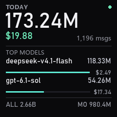

# Token 用量看板（真实在用的例子）



这是作者本人桌面上**真的在跑**的那块屏：水冷头上显示今天的 token 消耗、花费，
以及 Top2 模型的占比。它比 `examples/` 里那几个例子复杂一档 —— 有数据层、有排版规则、
有刷新节流 —— 所以更适合当成「要动手做一个自己的面板」时的参考实现。

```
demos/token-board/
├── data.py           数据层：读 Token Monitor 的 SQLite 归档 / 退回演示数据
├── render.py         画面层：dict → 240×240 PIL.Image（纯渲染，不碰 USB）
├── run.py            调度层：取数节流 + 推流 + Ctrl+C 退出
├── sample-data.json  演示数据，没装 Token Monitor 也能出图
└── README.md
```

跑起来：

```bash
python demos/token-board/run.py --once --save frame.png   # 只出图，不连设备
python demos/token-board/run.py --source sample          # 用演示数据推到屏上
python demos/token-board/run.py                          # 自动取数，一直跑
python demos/token-board/run.py --refresh 5 --fps 4      # 5 秒取一次数，4 fps
```

---

## 一、数据从哪来

`data.py` 读的是 **Token Monitor** 这个软件的本地归档：

```
%APPDATA%\Token Monitor\session-usage-archive.sqlite
  └─ 表 sessions，列 entry_json
       └─ periods.today = { totalTokens, costUsd, messageCount, models, modelCosts }
```

两个坑写在代码注释里，这里再强调一遍：

1. **必须读副本，不能直连。** 原程序跑着的时候是 WAL 模式，直接连上去会跟它抢写锁，
   轻则卡住它，重则读到半截事务。所以先 `sqlite3` 主库 + `-wal` + `-shm` 三件套复制到临时目录再查。
2. **字段全部 `.get()` 兜底。** 不同版本的字段名有出入，缺字段时显示 0 比抛异常好 ——
   屏上崩了，比数字不准更难受。

**你不需要装 Token Monitor。** `data.py` 里的 `_aggregate()` 接收的就是「一堆会话记录」，
把你的数据（CSV、HTTP 接口、Prometheus、`claude`/`codex` 自己的账单）映射成同结构的 dict 就行：

```python
data = {
    "today":    {"tokens": 155330000, "cost": 16.67, "messages": 1046},
    "month":    {"tokens": 412860000, "cost": 42.31, "messages": 2884},
    "all_time": {"tokens": 1284000000, "cost": 131.77, "messages": 9137},
    "top_models": [
        {"name": "deepseek-v4.1-flash", "tokens": 77620000, "cost": 1.68},
        {"name": "gpt-6.1-sol",         "tokens": 49570000, "cost": 14.20},
    ],
}
```

然后 `render.draw_board(data)` 就得到一帧。`render.py` 里没有任何 USB 相关代码，
在 Linux / macOS 上也能跑，方便调版式。

---

## 二、排版规则（这几条是踩出来的）

1.5 寸屏、240×240，像素密度比手机还高，**但眼睛离得远**。所以：

| 规则 | 为什么 |
|---|---|
| 正文最小 12px，模型名 15px，主数字 44px | 10px 的中文在这块屏上基本糊成一团 |
| 上下各留 6~12px，任何文字不进边框 8px 内 | 面板有圆角，贴边的字会被切掉 |
| 每个模型占两行，不挤成一行 | 一行要塞「名称 + token + 费用」，中文名一长就打架 |
| 费用列宽度按两行**最大值**预留 | 不预留的话，两条占比条右端不齐，看着很脏 |
| 中英混排用 `getmetrics()[0]` 的差做基线 | 同一个 y 画出来，中文会明显比西文低一截 |
| Top2 而不是 Top5 | 一屏只放得下两个够大的字，剩下的边际价值低 |

细节都在 `render.py` 的注释里，改版式之前建议先读一遍。

---

## 三、刷新策略

- **画面 2 fps 重推。** 不是数据变了才推 —— 长时间不写 USB，屏会闪回厂商 logo。
- **数据 15 秒取一次。** 复制 SQLite + 聚合要几毫秒，每帧都做纯属浪费，也更容易撞上写锁。
- **取数失败不清屏。** 出错就沿用上一份数据，屏上继续显示旧值，而不是变成一张错误提示。

这三条合起来，就是一个能开机常驻、不闪、不崩的最小实现。
要加开机自启，见 [docs/AI-PROMPT.md 第五节](../../docs/AI-PROMPT.md#五如果你要的是开机自启--常驻)。
